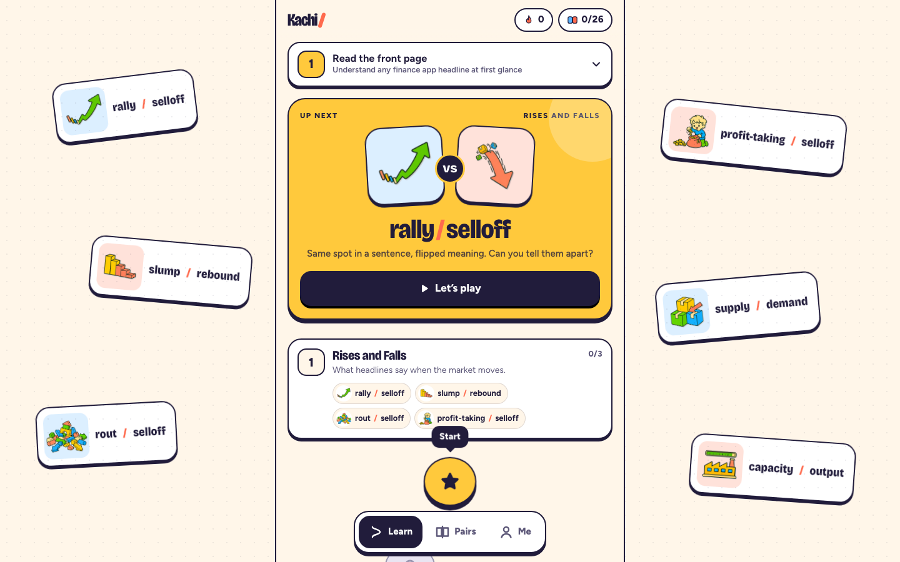
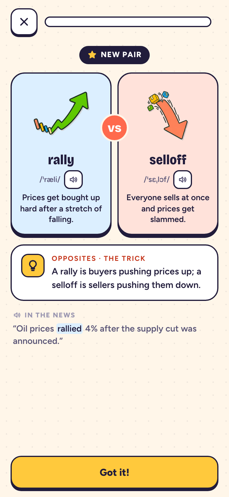

# Kachi

**English** · [简体中文](README.zh-CN.md)

Kachi teaches finance English **in pairs**: rally / selloff, revenue / earnings,
coupon / yield, hedge / pledge. In a headline, one wrong word flips the story,
so every word arrives beside the twin it gets confused with, and every question
is decided by the difference.

**6 levels · 238 concepts · 145 confusion pairs · 125 lessons · 1,668 prompts.**
Offline PWA, no account, progress stays on the device. English interface by
default, 中文 one tap away. Live at [kachi-game.vercel.app](https://kachi-game.vercel.app).

<p align="center">
  
</p>
<p align="center">
  
</p>

## How it works

- **Twin teach cards.** A new pair shows up as two cards side by side: art,
  IPA, recorded audio and a plain caption for each, plus the one-line trick that
  separates them. Each pair is tagged with one of seven mix-up kinds, named so a
  twelve-year-old gets them: Opposites, Which way?, Which moment?, Whole vs.
  slice, Family, Look-alikes, Sentence buddies.
- **Questions decided by the twin.** Meaning, scenario and true/false items
  always offer the twin as a distractor, and fill-in word banks always contain
  it. A lesson interleaves its words (rally, selloff, slump, then round two)
  instead of asking about one word four times in a row. Answer options are words
  only: a picture next to "rally" would give the answer away.
- **Eight exercise types:** meaning, scenario, true/false, fill-in, match,
  listen, read-the-news headlines (levels 1–4) and spot-the-flaw audits (level 5).
- **No hearts, no failing.** A miss comes back once at the end of the lesson as
  a rehearsal (no XP, no mastery credit). Combos reward runs; the hedgehog
  mascot, a soft chime and a short vibration give feedback. All motion, sound
  and haptics follow one Effects slider.
- **Spaced review.** Mastery is tracked per pair on a 1, 3, 7, 14, 30, 60-day
  ladder. Due pairs appear on the home screen and are badged in the album.
- **Three tabs.** _Learn_ is the path, with the next pair up front. _Pairs_ is
  an album of every confusion pair; unmet ones show as silhouettes. _Me_ holds
  your streak, the pairs you slip on most, language, effects and your data.
- **Pair cards.** Any pair you've met can be exported as a 1080×1440 PNG card.

## Levels

Levels follow what you are reading, not which discipline a word belongs to.
Every level is open; level 1 is where a new learner starts.

| Level | Pack                  | When it's done, you can…                          | Concepts |
| ----- | --------------------- | ------------------------------------------------- | -------- |
| 1     | `t1-finance-news`     | Understand any finance app's headlines            | 42       |
| 2     | `t2-company-earnings` | Tell whether a quarterly release is good news     | 49       |
| 3     | `t3-bonds-rates`      | Follow yield, auction and maturity stories        | 38       |
| 4     | `t4-forex-macro`      | Read currency, central-bank and policy news       | 37       |
| 5     | `t5-quant-research`   | Spot which backtest claim does not hold           | 32       |
| 6     | `hedge-or-pledge`     | Read private-bank and structured-product material | 40       |

Every word must appear in the level's real-news corpus before it is taught
(`content/corpus`, enforced at build time). Course text is original: each pack
ships `zh-CN` and `en-US` `course.json` files, generated from `source.mjs` for
levels 1–5 and hand-written for level 6. The validator keeps the two locales
structurally identical. Original headline drills live in
`content/packs/*/headlines.mjs`. Fill sentences for words whose corpus example
never uses the term itself live in `content/packs/fill-overrides.mjs`.

## Commands

```bash
pnpm install
pnpm run dev              # vite dev server
pnpm run test             # vitest
pnpm run check            # biome + content validation + tsc + vitest + vite build + build boundaries
pnpm test:e2e             # production build + Playwright (desktop and mobile)
pnpm run generate:course  # regenerate content/packs/*/{zh-CN,en-US}/course.json from source.mjs
pnpm run generate:art     # draw missing term art (then strips the white ground)
pnpm run strip:art        # make term art transparent; idempotent
pnpm run generate:icons   # rebuild PNG icons from public/icon.svg (needs rsvg-convert)
```

## Notes

- **Offline first.** Level 1's English edition is in the main bundle (about
  509 kB initial JS against a 650 kB budget), so the first screen always
  renders. Every other edition, including level 1 in Chinese, is a lazy chunk
  that the service worker precaches. If a stored Chinese preference cannot load,
  the app falls back to the bundled English.
- **Switching is atomic.** Level and language switch together only after the
  course has loaded. A failure keeps the current course and offers a retry
  inside the level picker. The chosen level and language are remembered.
- **Your data.** Progress lives in IndexedDB on this device. Export and import
  are under _Me_, and nothing is sent anywhere.
- **Art.** Term art is transparent WebP. Generated images get their white
  ground removed by `scripts/strip-art-background.mjs`; interior whites survive
  and the drop shadow becomes translucent ink.
- **Type.** Fonts are self-hosted: Bricolage Grotesque for display, Figtree for
  text. Chinese uses the system CJK face.
- **No dark mode, on purpose.** The warm-paper, ink-outline look is the brand.
  Revisit only for a real night-reading use case.
- CI (`.github/workflows/ci.yml`) runs `pnpm run check` on every push and PR.
  Lefthook runs biome on staged files.

## Docs

Every document leads in English, with a Chinese edition beside it.

| English                                                | 中文                                                               | What it covers                                                                         |
| ------------------------------------------------------ | ------------------------------------------------------------------ | -------------------------------------------------------------------------------------- |
| [docs/vocabulary-system.md](docs/vocabulary-system.md) | [docs/vocabulary-system.zh-CN.md](docs/vocabulary-system.zh-CN.md) | The six tiers, confusion-pair types, cross-pack deduplication, the two authoring gates |
| [docs/upgrade-plan.md](docs/upgrade-plan.md)           | [docs/upgrade-plan.zh-CN.md](docs/upgrade-plan.zh-CN.md)           | What is not built yet, and what is deliberately not being built                        |

## License

- Code: [AGPL-3.0-only](LICENSE).
- Original course and teaching content (`content/`): CC-BY-SA-4.0.
- Third-party news quotations, links and brands keep their own rights and are
  not relicensed with the course pack.
