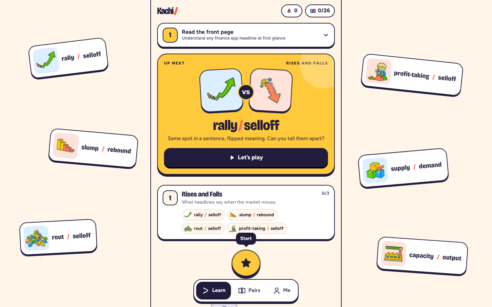
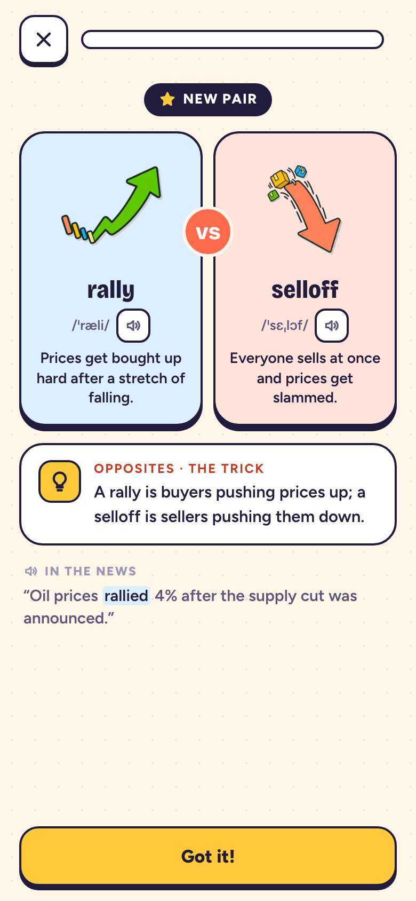

# Kachi

[English](README.md) · **简体中文**

Kachi 把财经英语里容易搞混的词**成对**来教：rally / selloff、revenue / earnings、coupon / yield、hedge / pledge。财经标题里错一个词，整条消息的意思就反了，所以每个词都和它的「双胞胎」一起出现，每道题都要靠分清两者才能答对。

**6 个等级 · 238 个概念 · 145 组易混词对 · 125 节课 · 1697 道题。** 离线可用的 PWA，无需账号，学习进度只存在本机。界面默认英文，可一键切换中文。线上地址：[kachi-game.vercel.app](https://kachi-game.vercel.app)。

<p align="center">
  
</p>
<p align="center">
  
</p>

## 怎么学

- **双胞胎教学卡**：新词对以左右两张卡出现，每张卡有插画、音标、真人发音和一句大白话解释，下面是一句区分两者的窍门。每组词对都标出七种易混类型之一，用孩子也能看懂的说法：反义词、往哪走、哪个时候、整体与部分、一家人、长得像、总在一起。
- **题目都考两个词的区别**：选意思、是哪个词、判断对错这三类题的选项里一定有它的双胞胎，填空题的词库里也一定有。一课里的题目轮流出现（rally、selloff、slump 各问一题，再进入下一轮），不会一个词连问四题。选项只显示词、不配图：「rally」旁边放个上涨箭头，就等于把答案告诉了你。
- **八种题型**：选意思、是哪个词、判断对错、填空、连线、听音选词、读新闻标题（第 1–4 级）、挑毛病（第 5 级）。
- **研报与量化练习**：第 5 级有 36 道原创英文研报案例，24 道进入单元练习，另有 12 道新案例放在六个复习关的开头。练习涵盖诊断漏洞、核算数字、选择验证方法和判断结论边界。
- **没有爱心，不会失败**：答错的题会在本课最后再考一次，这次只算复习，不加经验，也不计入掌握度。连续答对有连击奖励。答题反馈有小刺猬吉祥物的表情、一声轻提示音和手机短振，动效、音效和振动都由同一个「动效与音效」滑块控制。
- **间隔复习**：掌握度按词对记录，复习间隔依次为 1、3、7、14、30、60 天。到期的词对会出现在首页，词对图鉴里也会标出来。
- **三个标签页**：「学习」是课程路径，下一组词对放在最前面；「词对」是所有易混词对的图鉴，还没学过的显示为剪影；「我的」放连续学习天数、最容易搞混的词对、语言、动效和学习数据。
- **词对卡片**：学过的词对可以导出成 1080×1440 的 PNG 卡片。

## 等级

等级按「你在读什么」划分，不按词语所属的学科。所有等级都可以直接进入，新用户从第 1 级开始。

| 等级 | 课包                  | 学完能做到               | 概念数 |
| ---- | --------------------- | ------------------------ | ------ |
| 1    | `t1-finance-news`     | 看懂财经 App 首屏的标题  | 42     |
| 2    | `t2-company-earnings` | 判断一份季报是好是坏     | 49     |
| 3    | `t3-bonds-rates`      | 读懂收益率、拍卖、期限   | 38     |
| 4    | `t4-forex-macro`      | 看懂汇率、央行、政策     | 37     |
| 5    | `t5-quant-research`   | 指出回测结论哪里站不住   | 32     |
| 6    | `hedge-or-pledge`     | 读懂私行和结构性产品材料 | 40     |

一个词必须先在该等级的真实新闻语料里出现过，才会被收进课程（语料在 `content/corpus`，构建时校验）。课程文字全部原创：每个课包都有 `zh-CN` 和 `en-US` 两份 `course.json`，第 1–5 级由 `source.mjs` 生成，第 6 级为手写，校验脚本保证两种语言的结构一致。原创的读新闻标题题放在 `content/packs/*/headlines.mjs`。第 5 级的双语研报案例放在 `content/packs/t5-quant-research/audits.mjs`，其中数字均为教学假设，不是原文摘录或真实基金业绩。有些词的语料例句里没有出现这个词本身，这些词的填空句放在 `content/packs/fill-overrides.mjs`。

## 命令

```bash
pnpm install
pnpm run dev              # vite 开发服务器
pnpm run test             # vitest
pnpm run check            # biome + 内容校验 + tsc + vitest + vite 构建 + 构建边界检查
pnpm test:e2e             # 生产构建 + Playwright（桌面与手机）
pnpm run generate:course  # 由 source.mjs 重新生成 content/packs/*/{zh-CN,en-US}/course.json
pnpm run generate:art     # 生成缺失的词条插画（生成后自动去白底）
pnpm run strip:art        # 把插画转成透明底；可重复执行
pnpm run generate:icons   # 由 public/icon.svg 重建 PNG 图标（需要 rsvg-convert）
```

## 说明

- **离线优先**：第 1 级英文版打进主包（首屏 JS 约 509 kB，预算 650 kB），所以首屏总能显示。其余版本（包括第 1 级中文版）都是懒加载分块，由 service worker 预缓存。如果用户设置的是中文、但中文版加载不出来，会回落到内置的英文版。
- **切换是原子的**：只有课程加载成功后，等级和语言才会一起切换。加载失败时保留当前课程，并在等级面板里提供重试。选过的等级和语言都会被记住。
- **数据归你**：学习进度存在本机的 IndexedDB 里，可以在「我的」里导出或导入，不会上传到任何地方。
- **插画**：词条插画是透明底的 WebP。生成的插画由 `scripts/strip-art-background.mjs` 去掉白底，图内的白色保留，投影变成半透明的墨色。
- **字体**：字体本地托管，标题用 Bricolage Grotesque，正文用 Figtree，中文使用系统字体。
- **有意不做深色模式**：暖色纸面加墨线描边就是品牌风格。除非出现真实的夜间阅读需求，否则不做。
- CI（`.github/workflows/ci.yml`）在每次 push 和 PR 时运行 `pnpm run check`，lefthook 会对暂存文件运行 biome。

## 文档

每份文档以英文为主，中文版放在旁边。

| 英文                                                   | 中文                                                               | 内容                                         |
| ------------------------------------------------------ | ------------------------------------------------------------------ | -------------------------------------------- |
| [docs/vocabulary-system.md](docs/vocabulary-system.md) | [docs/vocabulary-system.zh-CN.md](docs/vocabulary-system.zh-CN.md) | 六个层级、混淆对类型、跨包去重、两道作者门禁 |
| [docs/upgrade-plan.md](docs/upgrade-plan.md)           | [docs/upgrade-plan.zh-CN.md](docs/upgrade-plan.zh-CN.md)           | 还没做的，以及明确不做的                     |

## 许可

- 代码：[AGPL-3.0-only](LICENSE)。
- 原创课程与教学内容（`content/`）：CC-BY-SA-4.0。
- 第三方新闻引文、链接与品牌各自保留权利，不随课程包重新授权。
