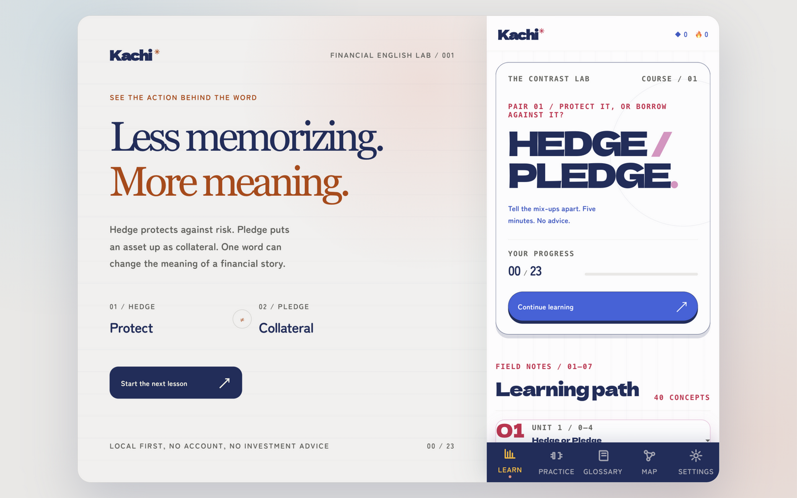

# Kachi

[English](README.md) · **简体中文**

财经英语学习 PWA：可离线使用的课程流程，含词汇、测验与可分享的进度卡片。**6 个课包、238 个概念、125 节课、1631 道题**，无需账号，全部保存在本机。线上站点：[kachi-game.vercel.app](https://kachi-game.vercel.app)。

界面默认英文，一键切到中文。课程内容放在 `content/`，构建时校验。

<p align="center">
  
</p>

截图展示的是默认课包（40 个概念）——首页始终显示当前所在课包的数字，不是全站合计。

## 课程

课包按层级解锁，每个课包都围绕「容易混淆的词对」组织——分辨本身就是课程。

| 层级 | 课包                  | 主题               | 概念数 |
| ---- | --------------------- | ------------------ | ------ |
| 1    | `t1-finance-news`     | 读财经首页         | 42     |
| 2    | `t2-company-earnings` | 读公司财报         | 49     |
| 3    | `t3-bonds-rates`      | 读债券与利率       | 38     |
| 4    | `t4-forex-macro`      | 读外汇与宏观       | 37     |
| 5    | `t5-quant-research`   | 读研报与量化       | 32     |
| 6    | `hedge-or-pledge`     | 借款与对冲（手写） | 40     |

每个课包都有 `zh-CN` 与 `en-US` 两份 `course.json`；校验脚本强制两者结构对齐。

## 命令

```bash
pnpm install
pnpm run dev              # vite 开发服务器
pnpm run test             # vitest
pnpm run check            # biome + 内容校验 + tsc + vitest + vite 构建（PWA）
pnpm run generate:course  # 由 source.mjs 重新生成 content/packs/*/{zh-CN,en-US}/course.json
pnpm run generate:icons   # 由 public/icon.svg 重建 PNG 图标（需要 rsvg-convert）
```

## 说明

- 界面默认英文，语言偏好存在 `localStorage`，中文在设置里切换。
- **默认课包**（`hedge-or-pledge`）两种语言都打进主包，首屏无论断网还是恢复了哪种语言都能渲染。其余课包是懒加载分块，由 service worker 预缓存——一次联网后所有课程都可离线使用。行为改动要落到构建产物，不能只改源码。
- CI（`.github/workflows/ci.yml`）在每次 push/PR 跑 `pnpm run check`。
- 提交前钩子（lefthook）对暂存文件跑 biome。
- `public/icon.svg` 是图标唯一出处；生成的 PNG 变体要提交，和 `og-image.png` 一样。
- 深色模式有意不做：墨纸「笔记本」就是品牌。除非有真实夜间阅读场景，不要因为「缺了」而加。

## 加载、数据与离线检查

课程加载成功后，课包、语言和内容一起切换。加载失败保留正在使用的课程并提供重试；较早请求的结果不能覆盖新选择。设置、词汇表、地图、练习和分享界面按需加载。导出使用当前内存中的学习进度，IndexedDB 不可用时也能保存本次进度。分享卡使用原生对话框，支持焦点约束、Escape 关闭和焦点返回。

`scripts/verify-build.mjs` 检查初始 JavaScript 不超过 650 kB、CSS 不超过 100 kB，并核对额外课程分块数量及全部 JS/CSS 的离线预缓存。首次运行 `pnpm exec playwright install chromium`，再执行 `pnpm test:e2e`，验证生产构建的双语切换、失败重试、离线刷新、进度恢复与分享图片下载；CI 保存失败跟踪。

## 文档

每份文档以英文为主，中文版并列放在旁边。

| 英文                                                   | 中文                                                               | 内容                                         |
| ------------------------------------------------------ | ------------------------------------------------------------------ | -------------------------------------------- |
| [docs/vocabulary-system.md](docs/vocabulary-system.md) | [docs/vocabulary-system.zh-CN.md](docs/vocabulary-system.zh-CN.md) | 六个层级、混淆对类型、跨包去重、两道作者门禁 |
| [docs/upgrade-plan.md](docs/upgrade-plan.md)           | [docs/upgrade-plan.zh-CN.md](docs/upgrade-plan.zh-CN.md)           | 还没做的，以及明确不做的                     |

## 许可

- 代码：[AGPL-3.0-only](LICENSE)。
- 原创课程与教学内容（`content/`）：CC-BY-SA-4.0。
- 第三方新闻引文、链接与品牌各自保留权利，不随课程包重新授权。

English readme: [README.md](README.md).
